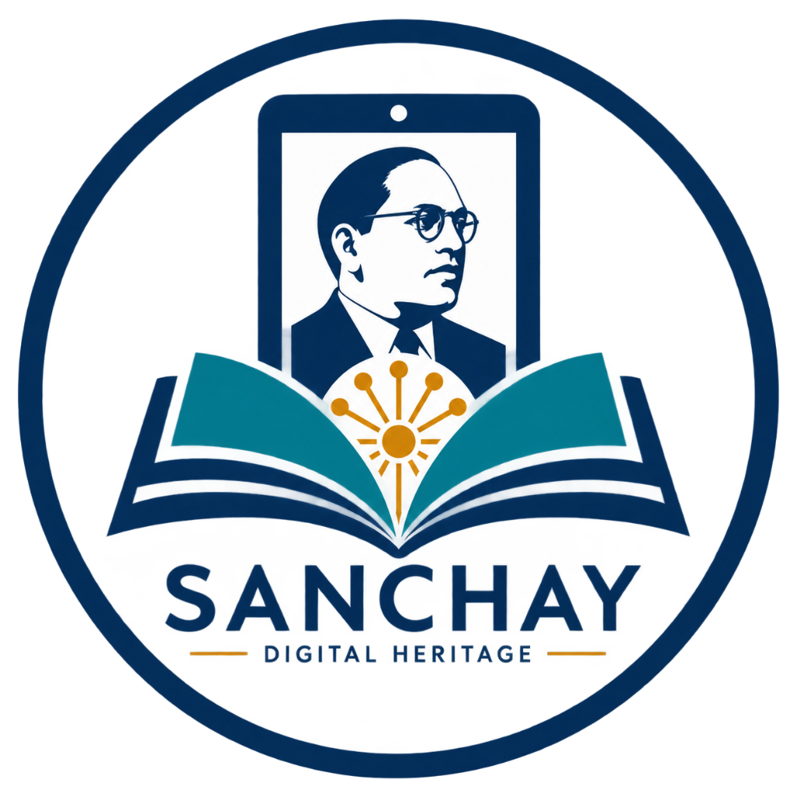
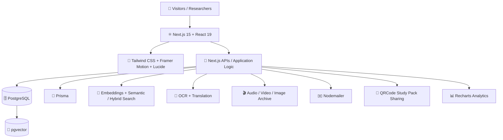

# 🏛️ SANCHAY — Dr. B. R. Ambedkar Digital Heritage Archive

<p align="center">
  
</p>

<p align="center">
  <strong>Preserve • Explore • Learn • Connect</strong><br/>
  AI-powered digital heritage archive dedicated exclusively to <strong>Dr. B. R. Ambedkar</strong>.
</p>

<p align="center">
  <a href="https://github.com/pranita614/Sanchay-Project">GitHub</a> •
  <a href="https://baws.in/">BAWS</a> •
  <a href="https://www.drambedkarwritings.gov.in/">Government of India Archive</a>
</p>

---

## 🌟 About Sanchay

**Sanchay** brings Ambedkar's writings, speeches, books, letters, photographs, audio, video and historical milestones into one research-oriented digital archive.

### 🎯 Core Goals

| | Goal | Purpose |
|---|---|---|
| 📚 | **Preserve** | Organize archival records with provenance and source metadata |
| 🔎 | **Discover** | Explore writings, speeches, media, documents and timelines |
| 🤖 | **Research** | Search, OCR, citations, embeddings and AI-assisted exploration |
| 🌐 | **Access** | Make content easier to use across devices and languages |
| 🏛️ | **Manage** | Support reviews, roles, analytics and institutional workflows |

## ✨ Key Features

| Feature | What it offers |
|---|---|
| 📖 **Digital Archive** | Books, writings, speeches, letters, photographs and documents |
| 🕰️ **Interactive Timeline** | Major events and milestones from Ambedkar's life and work |
| 🎙️ **Audio Archive** | Archival audio, speeches and related recordings |
| 🎬 **Video Archive** | Verified archival films and visual records |
| 🔍 **AI Research** | Full-text, semantic/hybrid retrieval and source-linked answers |
| 🧠 **OCR & Translation** | Digitization, review and multilingual access |
| 🗺️ **Mind Map** | Explore connections across topics and archival material |
| 📌 **Study Pack** | Save items and take them home via QR or email |
| 🏛️ **Staff CMS** | Review, approval, provenance, analytics and audit workflows |

## 🏗️ Technology Stack



### 🧰 Stack at a Glance

| Layer | Technology |
|---|---|
| ⚛️ Frontend | Next.js 15 • React 19 • TypeScript |
| 🎨 UI | Tailwind CSS • Framer Motion • Lucide React |
| 🗄️ Database | PostgreSQL • Prisma • pgvector |
| 🤖 AI & Search | Embeddings • Semantic Search • Hybrid Search |
| 📄 Processing | OCR • Translation • TTS integration |
| ✉️ Communication | Nodemailer |
| 📱 Sharing | QRCode |
| 📊 Analytics | Recharts |

## 📁 Project Structure

```text
Sanchay-Project/
├── app/              # Next.js routes and pages
├── components/       # Reusable UI
├── data/             # Seed/application data
├── lib/              # Database and application logic
├── prisma/           # Schema and seed
├── public/images/    # Archive and UI images
├── package.json
├── .env.example
├── .gitignore
└── README.md
```

## 🚀 Getting Started

### 1️⃣ Clone

```bash
git clone https://github.com/pranita614/Sanchay-Project.git
cd Sanchay-Project
```

### 2️⃣ Install

```bash
npm install
```

### 3️⃣ Configure environment

```bash
copy .env.example .env
```

macOS/Linux:

```bash
cp .env.example .env
```

Add your local database/API values. **Never commit `.env` or real secrets.**

### 4️⃣ Database

```bash
npx prisma generate
npx prisma migrate dev
npm run seed
```

### 5️⃣ Run

```bash
npm run dev
```

Open **http://localhost:3000**

## 🧰 Scripts

```bash
npm run dev      # Development server
npm run build    # Production build
npm run start    # Production server
npm run lint     # Linting
npm run seed     # Seed development data
```

## 📚 Archival Integrity

Sanchay is designed for source-first historical research:

- ✅ Preserve source URLs, credits, rights and provenance.
- ✅ Prefer verified institutional/archival records.
- ✅ Keep original media distinct from OCR, translations and TTS.
- ❌ Do not fabricate quotations, citations, dates, people or historical media.
- ❌ Do not present AI-generated imagery or synthetic speech as authentic archival material.

Reference sources include **BAWS**, the **Government of India Dr. Ambedkar Writings & Speeches portal**, and independently verified Internet Archive records.

## 📌 My Study Pack

Visitors can save useful archive items while exploring Sanchay:

```text
Explore → Save to My Study Pack → Review → Take My Study Pack
                                      ↙          ↘
                              Generate QR      Send Email
```

The pack references existing archive items instead of copying large media files.

## 🗺️ Roadmap

- 🔎 Deeper semantic & hybrid search
- 🤖 Expanded grounded RAG workflows
- 🌐 Multilingual archival experiences
- 📝 OCR / transcript review tools
- 🏛️ Digital preservation workflows
- 📺 Kiosk & smart-display modes
- 📊 Institutional analytics

---

<p align="center">
  <strong>SANCHAY</strong><br/>
  Digital Heritage Archive of Dr. B. R. Ambedkar 🇮🇳
</p>
